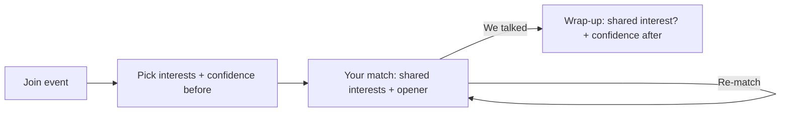

# WarmUp v1: Quickly identify common interest

**Job:** Quickly identify common interest.
**Who:** A student at a campus club social (student screens only; the event is pre-set in sample data).
**Format:** One browser page (`repo-app-name/index.html`) with fake sample data. No login, no server, no installs. Data is saved in the browser (local storage).

**Goal:** A student opens WarmUp at a club social, picks their interests and sees what they share with another attendee within a minute.

## Screens

1. **Join event (`#home`).** Shows the sample event's name and the host's welcome line. The student types a first name and taps "Join WarmUp".
2. **Pick your interests (`#interests`).** The student taps 3 to 5 interest chips. Before continuing, they rate their confidence: "How confident do you feel talking to someone new?" (1 to 5).
3. **Your match (`#match`).** Shows one sample attendee, with the shared interests highlighted at the top. Below that is one suggested opener based on a shared interest.
   - "Not vibing? Re-match" shows the next sample attendee.
   - "We talked" goes to Wrap-up.
4. **Wrap-up (`#wrapup`).** Asks "Did you discover a genuine shared interest?" (yes or no), then the same 1-to-5 confidence question again. Ends with a thank-you message.

## Main flow

1. Open the page and join the sample event.
2. Pick interests and rate your confidence before.
3. See your match and what you have in common.
4. Re-match if you want, or go talk to them.
5. Answer the two wrap-up questions.

## Sample data (fictional, for the demo only, not research)

- **One event:** "Outdoor Club Fall Social", with a one-line welcome from the host (no "[Sample]" label in the UI, per team)
- **12 interests:** hiking, gaming, cooking, music, basketball, anime, photography, coffee, movies, travel, coding, art
- **6 sample attendees:** first name, year and 3 to 4 interests each
- **One opener per interest**, for example coffee: "Ask where the best coffee on campus is"

## Out of scope today

- Organizer screens (the event is pre-set in sample data)
- Accounts and login, and sending results anywhere
- Real matching between different laptops
- Timed rounds and rotation, contact exchange, and follow-up prompts
- Classes and other settings, and publishing to a public link
